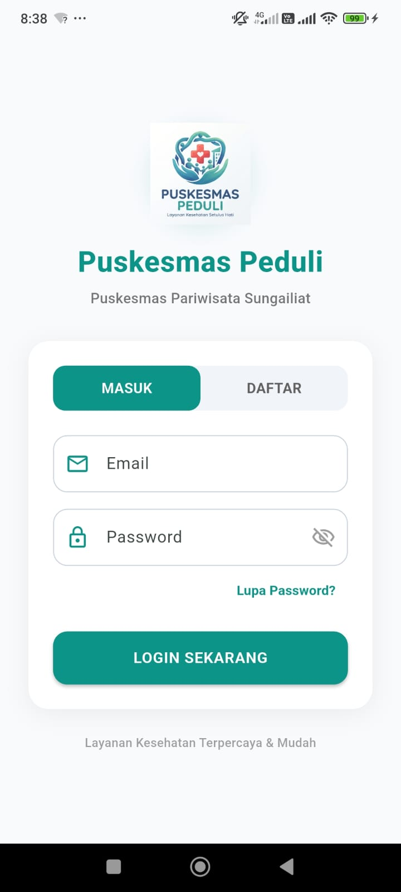
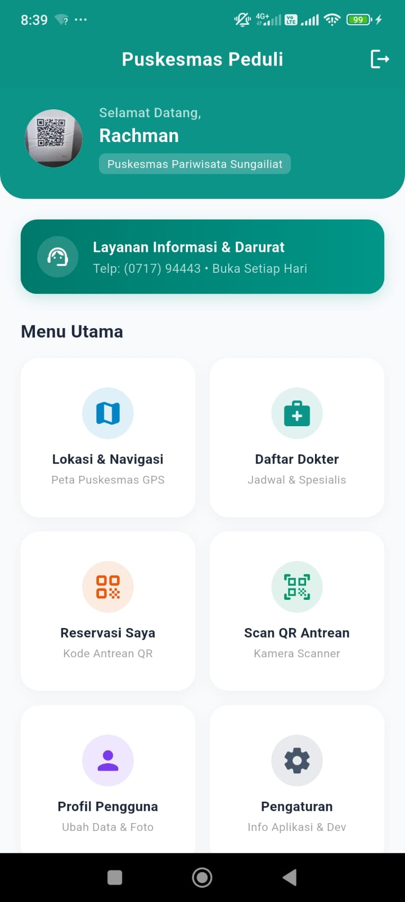
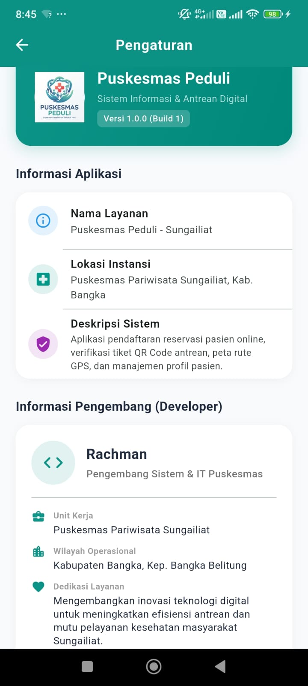
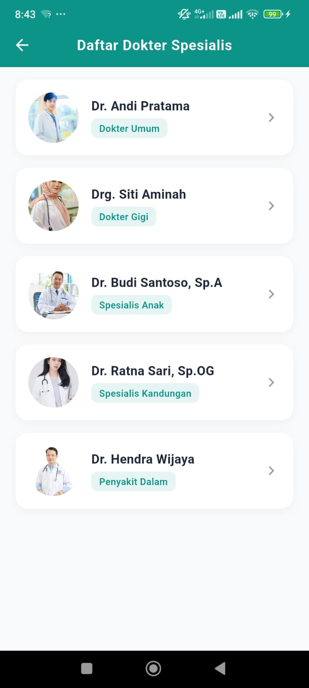
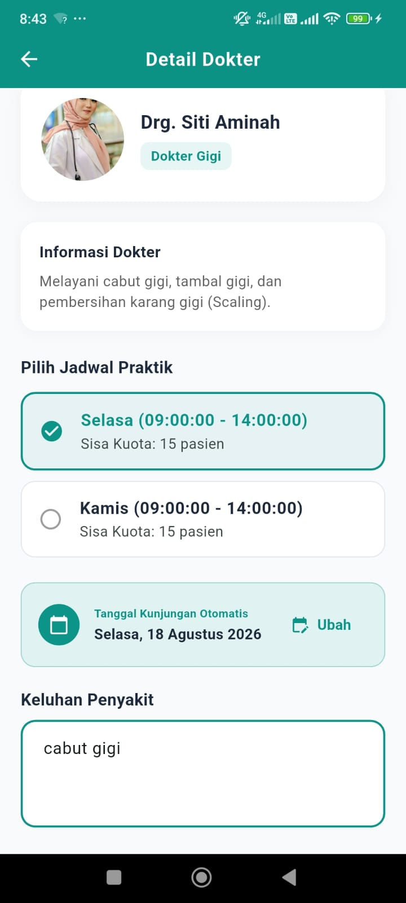
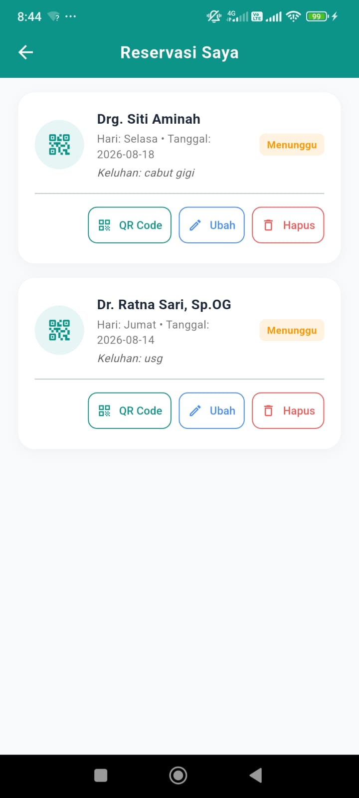
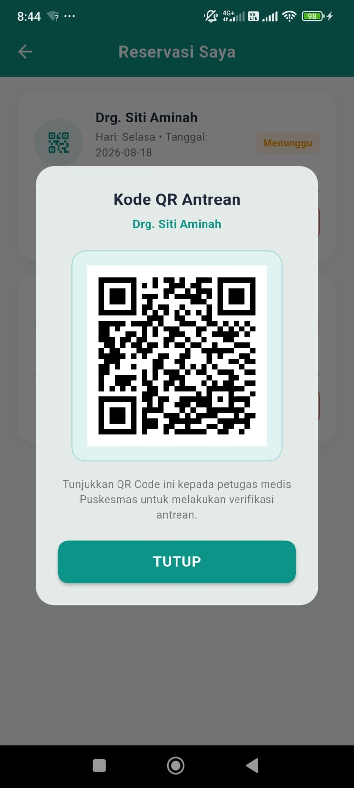
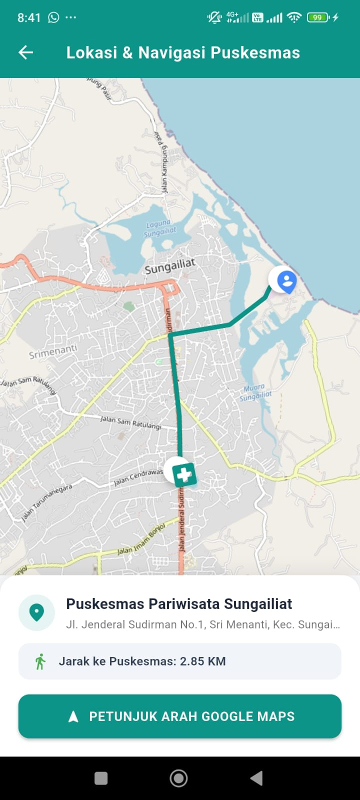
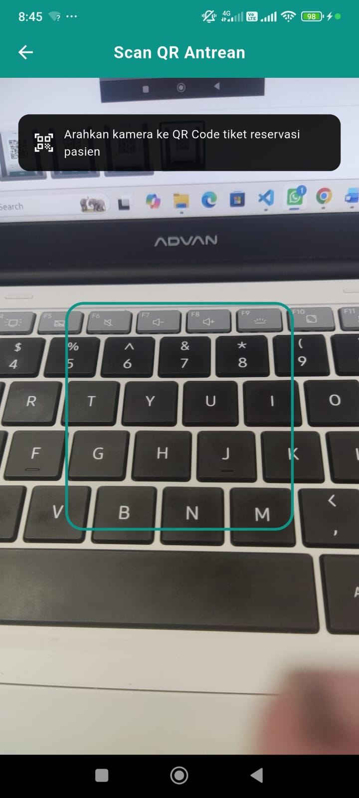
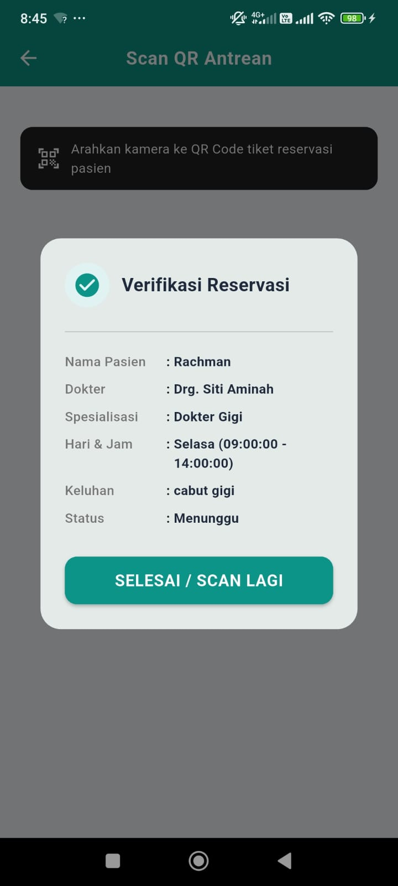

# 🏥 Puskesmas Peduli (Smart Health App)

[](https://flutter.dev)
[](https://dart.dev)
[](https://supabase.com)
[](https://www.postgresql.org)
[](#)
[](#)

> **Puskesmas Peduli** adalah aplikasi mobile layanan kesehatan primer cerdas berbasis **Flutter** dan **Supabase (PostgreSQL)**. Dirancang untuk memecahkan permasalahan antrean panjang di loket fisik, mempermudah pasien melihat ketersediaan jadwal dokter spesialis secara real-time, menyederhanakan verifikasi tiket melalui kode QR, serta menyediakan navigasi rute GPS terintegrasi menuju fasilitas kesehatan.

---

## 📸 Tampilan Antarmuka Aplikasi (Screenshots)

### 1. Autentikasi & Beranda Utama
| Layar Masuk / Login | Beranda & Layanan Cepat | Pengaturan Akun & Faskes |
|:---:|:---:|:---:|
|  |  |  |

### 2. Katalog Dokter & Alur Reservasi Antrean
| Daftar Dokter Spesialis | Detail Dokter & Jadwal | Riwayat Tiket Pasien | Kode QR Antrean Digital |
|:---:|:---:|:---:|:---:|
|  |  |  |  |

### 3. Peta Navigasi GPS & Pemindai QR Loket
| Peta & Garis Rute (OSM & OSRM) | Pemindai Kamera Loket | Validasi Hasil Scan Tiket |
|:---:|:---:|:---:|
|  |  |  |

---

## 🌟 Fitur Unggulan

### 1. 🗺️ Peta Lokasi & Navigasi Cerdas (OpenStreetMap + Geolocator)
* **Bebas Ketergantungan API Berbayar:** Menggunakan `flutter_map` berbasis OpenStreetMap (OSM), tanpa memerlukan billing credit card Google Maps Platform.
* **Deteksi Posisi Presisi:** Pemanfaatan `geolocator` untuk memperoleh koordinat GPS pengguna dengan penanganan izin bertingkat (*permission handling*).
* **Kalkulasi Jarak Matematis:** Menghitung jarak lurus (*Haversine*) antara posisi pasien dan Puskesmas secara akurat (format KM).
* **Jalur Rute Berkendara Real-Time:** Integrasi **OSRM (Open Source Routing Machine)** untuk menarik geometri jalan (*GeoJSON coordinates*) dan memetakannya menjadi garis *Polyline* di layar.
* **Auto-Fit Camera Bounds:** Kamera otomatis menyesuaikan posisi (*zoom & padding*) agar posisi pasien dan puskesmas tampak seimbang.
* **Direct Turn-by-Turn Redirection:** Tombol terintegrasi untuk meluncurkan Google Maps Navigasi langsung dengan mekanisme *cascading deep link* (`google.navigation` ➔ `geo:` ➔ `https://`).

### 2. 🎫 Sistem Antrean & Tiket Digital Berbasis QR Code
* **Kalkulasi Tanggal Cerdas:** Logika algoritma `_hitungTanggalTerdekat()` otomatis menyesuaikan tanggal kunjungan terdekat berdasarkan hari praktik dokter.
* **Pembuatan Tiket Instan:** Memanfaatkan `qr_flutter` untuk meng-generate gambar kode QR vektor dari ID unik reservasi pasien.
* **Pemindai Kamera Loket Medis:** Memanfaatkan `mobile_scanner` (CameraX native) dengan kontrol *lifecycle* kamera yang aman untuk mencegah *spam duplicate query*.
* **Relational Data Join:** Menampilkan rincian data lengkap pasien, dokter, poliklinik, dan keluhan melalui kueri relasional multi-tabel dalam 1 kali *fetch*.

### 3. 🔐 Keamanan & Autentikasi Modern
* **Supabase JWT Authentication:** Manajemen sesi aman menggunakan token JWT terenkripsi.
* **Deep Linking Pemulihan Sandi:** Skema intent filter `io.supabase.flutter://reset-callback` yang mengarahkan tautan email reset password langsung kembali ke dalam aplikasi.
* **Row-Level Security (RLS):** Proteksi tingkat basis data PostgreSQL, memastikan pasien hanya berhak mengakses dan memodifikasi data reservasi miliknya sendiri.
* **Package Visibility Compliant:** Mendeklarasikan tag `<queries>` di `AndroidManifest.xml` agar kompatibel dengan kebijakan privasi Android 11+ (API 30+).

### 4. 👤 Profil Pasien & Cloud Media Storage
* Pengelolaan data pribadi dan kontak darurat pasien.
* Unggah foto profil pengguna langsung ke **Supabase Storage Bucket** (`foto-profil`) menggunakan pustaka `image_picker`.

---

## 🛠️ Tech Stack & Pustaka

| Komponen | Teknologi | Keterangan |
| :--- | :--- | :--- |
| **Framework** | Flutter 3.x (Dart 3.x) | Cross-Platform UI Framework dengan Material 3 Design |
| **Backend & Database** | Supabase (PostgreSQL) | Auth (JWT), PostgREST API Relational, Storage Bucket |
| **Peta & GIS** | `flutter_map`, `latlong2` | Rendering peta vektor/raster OpenStreetMap & geometri koordinat |
| **Sensor Lokasi** | `geolocator` (v13.0+) | Akses GPS native & kalkulasi jarak akurat |
| **Kode QR & Scanner** | `qr_flutter`, `mobile_scanner` | Generator vektor QR Code & Pemindai kamera native |
| **Media & Native Tool** | `image_picker`, `url_launcher` | Pemilih gambar galeri/kamera & deep linking sistem operasi |

---

## 🏛️ Arsitektur Direktori Proyek

Proyek ini menerapkan **Layered Architecture (Service-Model-View)** yang memisahkan tanggung jawab kode secara bersih:

```text
lib/
├── models/                     # Data Transfer Objects (DTO) & Serialisasi JSON
│   ├── dokter_model.dart       # Model entitas dokter & spesialisasi
│   ├── jadwal_praktik_model.dart # Model jadwal praktik & jam kerja
│   ├── profil_user_model.dart  # Model data pasien & avatar
│   ├── puskesmas_model.dart    # Model data koordinat GPS & info faskes
│   └── reservasi_model.dart    # Model tiket antrean & relasi poliklinik
│
├── services/                   # Business Logic & Kueri Database Supabase
│   ├── auth_service.dart       # Autentikasi, sign up, sign in, dan reset password
│   ├── dokter_service.dart     # Fetch daftar dokter dan jadwal
│   ├── profil_service.dart     # Update profil dan upload foto ke Storage Bucket
│   ├── puskesmas_service.dart  # Fetch titik koordinat lokasi fasilitas kesehatan
│   └── reservasi_service.dart  # CRUD tiket antrean dengan relational postgrest join
│
├── screens/                    # Presentation Layer (UI Widgets & State lokal)
│   ├── splash_screen.dart      # Splash screen dengan pengecekan auth session aktif
│   ├── login_screen.dart       # Layar login, registrasi, & dialog reset password
│   ├── home_screen.dart        # Dashboard utama & menu navigasi
│   ├── map_screen.dart         # Modul peta OSM, GPS Geolocator, & jalur rute OSRM
│   ├── daftar_dokter_screen.dart # Katalog dokter spesialis
│   ├── detail_dokter_screen.dart # Pemilihan jadwal & formulir booking antrean
│   ├── qr_reservasi_screen.dart# Riwayat tiket & penampil QR Code antrean
│   ├── scan_qr_screen.dart     # Kamera pemindai QR untuk loket verifikasi
│   ├── profil_screen.dart      # Ubah info profil & upload foto
│   └── pengaturan_screen.dart  # Pengaturan akun & info versi aplikasi
│
└── main.dart                   # Titik masuk aplikasi, inisialisasi Supabase, & tema Material 3
```

---

## 📊 Skema Basis Data Relasional (Supabase PostgreSQL)

> 💡 **File SQL Siap Pakai:** Seluruh DDL tabel, policy RLS, dan sample dummy data telah disediakan di dalam file [`supabase/schema.sql`](supabase/schema.sql). Anda tinggal copy-paste ke menu **SQL Editor** pada Supabase Dashboard.

```text
 [puskesmas]
   ├── id (uuid, PK)
   ├── nama (text)
   ├── alamat (text)
   ├── latitude (float8)
   ├── longitude (float8)
   └── no_telp (text)

 [profil_pengguna]
   ├── id (uuid, PK, FK -> auth.users.id)
   ├── nama_lengkap (text)
   ├── no_telp (text)
   ├── alamat (text)
   ├── foto_profil (text / URL Storage)
   └── created_at (timestamptz)

 [dokter]
   ├── id (uuid, PK)
   ├── puskesmas_id (uuid, FK -> puskesmas.id)
   ├── nama_dokter (text)
   ├── spesialisasi (text)
   ├── deskripsi (text)
   ├── foto_dokter (text / URL)
   └── created_at (timestamptz)

 [jadwal_praktik]
   ├── id (uuid, PK)
   ├── dokter_id (uuid, FK -> dokter.id)
   ├── hari (text)
   ├── jam_mulai (time)
   ├── jam_selesai (time)
   └── kuota (int4)

 [reservasi]
   ├── id (uuid, PK -> Di-encode menjadi QR Code)
   ├── pengguna_id (uuid, FK -> profil_pengguna.id)
   ├── jadwal_id (uuid, FK -> jadwal_praktik.id)
   ├── tanggal_kunjungan (date)
   ├── keluhan (text)
   ├── status (text)
   └── created_at (timestamptz)
```

---

## 🚀 Panduan Menjalankan Proyek (Getting Started)

### 1. Prasyarat Sistem
* [Flutter SDK](https://docs.flutter.dev/get-started/install) versi `^3.12.0` atau lebih baru
* [Dart SDK](https://dart.dev/get-dart) versi `^3.0.0`
* Akun aktif di [Supabase Dashboard](https://supabase.com)
* Perangkat Android / Emulator (disarankan Android 10 / API 29 ke atas)

### 2. Kloning Repositori
```bash
git clone https://github.com/USERNAME_ANDA/smarthealth-puskesmas.git
cd smarthealth-puskesmas/flutter_application_1
```

### 3. Unduh Dependensi
```bash
flutter pub get
```

### 4. Konfigurasi Proyek Supabase
Buka file `lib/main.dart` dan masukkan kredensial URL dan Anon Public Key proyek Supabase Anda:
```dart
void main() async {
  WidgetsFlutterBinding.ensureInitialized();

  await Supabase.initialize(
    url: 'https://YOUR-PROJECT-ID.supabase.co',
    anonKey: 'YOUR-ANON-PUBLIC-KEY',
  );

  runApp(const MyApp());
}
```

Pastikan Storage Bucket bernama `foto-profil` sudah dibuat di Supabase Storage dan berstatus *Public*.

### 5. Jalankan Aplikasi
```bash
# Debug Mode pada perangkat yang tersambung
flutter run
```

---

## 📱 Konfigurasi Native Android

File `android/app/src/main/AndroidManifest.xml` telah dioptimasi dengan konfigurasi berikut:

* **Izin Perangkat (Hardware Permissions):**
  ```xml
  <uses-permission android:name="android.permission.INTERNET" />
  <uses-permission android:name="android.permission.CAMERA" />
  <uses-permission android:name="android.permission.ACCESS_FINE_LOCATION" />
  <uses-permission android:name="android.permission.ACCESS_COARSE_LOCATION" />
  ```
* **Intent Filter Deep Linking (Reset Password Supabase):**
  ```xml
  <intent-filter>
      <action android:name="android.intent.action.VIEW" />
      <category android:name="android.intent.category.DEFAULT" />
      <category android:name="android.intent.category.BROWSABLE" />
      <data android:scheme="io.supabase.flutter" android:host="reset-callback" />
  </intent-filter>
  ```
* **Package Visibility Queries (`<queries>`):**
  Memastikan aplikasi dapat membuka tautan eksternal `geo:`, `google.navigation:`, dan `https:` pada sistem operasi Android 11+ (API 30+).

---

## 📄 Lisensi
Proyek ini didistribusikan di bawah lisensi **MIT License**. Silakan gunakan untuk keperluan pembelajaran dan pengembangan portofolio.
